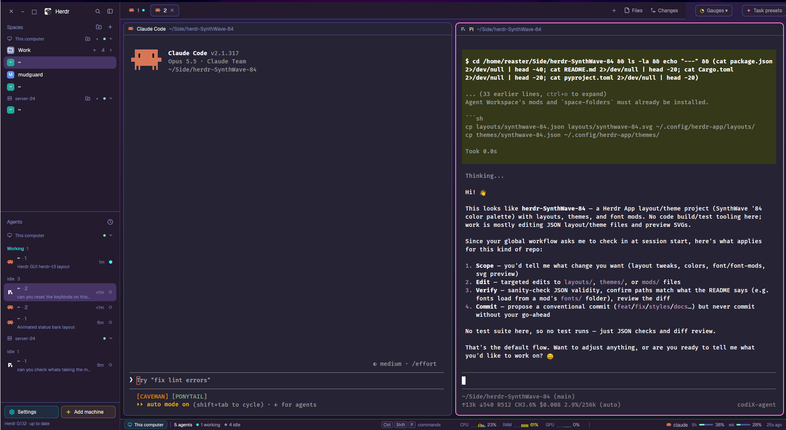

# SynthWave '84

A Herdr App layout in the colors of Robb Owen's SynthWave '84 VS Code theme: deep purple chrome, a dusk gradient behind the panes, neon pink focus ring and dividers, the theme's cyan, yellow, green and coral in the terminals, and DejaVu Sans Mono as the terminal font. It is a fork of Agent Workspace (sidebar with spaces, agents, quota and system gauges; tab bar with Files/Changes, Gauges and Task presets; status bar), with the look changed and nothing else.

## What you see

Left to right, top to bottom:

- **Sidebar**, 360px wide, background `chrome` (`#241b2f`), not resizable (min 44, max 480; narrower than 160px the mods draw a compact rail):
  - Brand header, 46px (`sw84-workspace-chrome`): window buttons (close, minimise, maximise) at the top left, the Herdr logo and name, search and sidebar-toggle buttons. Dragging it moves the window.
  - System gauges, 48px (`sw84-system-windows`, `monitorSlot: "sidebar-system"`) and quota usage, 145px (`sw84-quota`, `monitorSlot: "sidebar-quota"`); the Gauges button decides whether these sit here or in the status bar.
  - Spaces (`sw84-space-folders`) and Agents (`sw84-agents`) share the rest, weight 1 each, min 90px. When a remote machine is involved, both lists group by machine under a header (monitor/server icon, name, green dot when connected, fold chevron).
  - Footer, 69px (`sw84-workspace-chrome`, `footer: true`): Settings and Add machine pills, the Herdr version line.
- **Top bar**, 42px, not resizable: tabs as pills with window drag (`sw84-tabs`, weight 1), Gauges button 138px (`sw84-monitor-position`), Task presets button 110px (`sw84-task-presets`, `launcher: true`).
- **Work area**, padding 8, gap 8:
  - The shown tab's panes as cards: background `background` (`#262335`), 1px `#495495` border, 2px `#ff7edb` focus ring, radius 10, gap 8, framed even when alone, with a 30px header on top (`pane` mod: program icon, name, folder).
  - A right panel, 368px (min 280, max 900), hidden until opened: a stack of Files (`sw84-files`) and Changes (`changes`).
  - An agent resources panel, 370px (min 330, max 600), hidden (`sw84-agent-resources`).
- **Status bar**, 28px (`sw84-workspace-status`): machine pill, agent counts by state, key hints; optional CPU/RAM/GPU (360px) and quota (470px) blocks, hidden by default.

Everywhere: background gradient `#2b1d44` → `#171520` at 180°, dividers 1px `#ff7edb40`, terminal padding 14 × 12, no system title bar.

Palette (`themes/synthwave-84.json`): canvas `#171520`, chrome `#241b2f`, surface `#262335`, popover/raised `#2a2139`, hover `#37294d`, selected `#463465`, border `#495495`, input `#614d85`, foreground `#ffffff`, muted `#b6b1c7`, dim `#848bbd`, accent and solid `#ff7edb` (text on them `#241b2f`), working `#36f9f6`, blocked `#fede5d`, done `#72f1b8`, idle and unknown `#848bbd`. Terminal: background `#262335`, foreground `#ffffff`, selection `#463465`, cursor `#f97e72`, ANSI 0–15 `#241b2f #fe4450 #72f1b8 #f3e70f #03edf9 #ff7edb #03edf9 #b6b1c7 #848bbd #fe4450 #72f1b8 #fede5d #03edf9 #ff7edb #36f9f6 #ffffff`.

## How it behaves

- Agent states use the theme's colors: working is a still cyan dot (`#36f9f6`), blocked yellow, done green, idle a hollow grey ring. The agents list groups by state (Working, Idle, …) or by space, with pinned agents first; a folded group or machine shows its count and its most urgent state.
- Each agent row shows its program icon, space and tab, and a second line with what it works on (the terminal title the agent sets; for Pi, its session name).
- Clicking a space, tab or agent shows it; a machine or group header folds it.
- Files and Changes in the tab bar toggle the right panel; Gauges opens a popup that moves the CPU and quota gauges between the sidebar and the status bar; Task presets opens a dialog that starts an agent with a preset brief from `~/.agents/tasks.json`.
- The quota gauge lists only providers that `quota-axi` finds signed in. Its bars go green, yellow from 60%, bright red from 80%, red from 92%.
- `ctrl-shift-l` switches to the next layout.

## Built from

- `layouts/synthwave-84.json`: root `row` → `sidebar` column (brand, sidebar-system, sidebar-quota, sidebar-lists column [spaces, agents], sidebar-footer) and `work` column (topbar row [tabs, monitor-position-button, task-presets-button], work-body row [main tab block, panel column with a `panel-body` stack [files, changes], agent-resources-panel], status row [status-main, status-system, status-quota]). Root fields: `theme: "synthwave-84"`, `font: "DejaVu Sans Mono"`, `background` gradient, `divider`, `terminal_padding`, `titlebar: "none"`, `terminal_menu: "sw84-menu"`, `preview`.
- `themes/synthwave-84.json`: named like the layout, so Settings offers it only here.
- `mods/synthwave-84/`: draws nothing; its `fonts/` folder carries DejaVu Sans Mono Regular and Bold (Bitstream Vera licence, `LICENSE.txt`), which Herdr loads at start.
- Its own mods, modified copies of Agent Workspace's (Apache-2.0; quota and system gauges from herdr-quota, MIT) and herdr-space-folders' (MIT), renamed so they never replace an installed copy: `sw84-workspace-chrome`, `sw84-system-windows`, `sw84-quota`, `sw84-agents`, `sw84-tabs`, `sw84-monitor-position`, `sw84-task-presets`, `sw84-files`, `sw84-agent-resources`, `sw84-workspace-status`, `sw84-menu`, `sw84-new-menu`, `sw84-space-folders`. Shipped by Herdr: `changes`, `pane`, `worktree`, `picker`, `machine-add`, and icons from `workspace-chrome` and `files`.
- Programs the mods run: `quota-axi` (quota), `node` (system gauges, agent resources, task presets), `sh`, `python3` (Pi's first message), a desktop system monitor (`gnome-system-monitor`, `plasma-systemmonitor`, `mate-system-monitor`, `xfce4-taskmanager`, `lxtask`), `hc` (agent terminals), `git` (spaces, changes); on Windows `pwsh`/`powershell`.

## Watch out

- Herdr can't draw coloured shadows or text glow, and it draws terminal text itself: the neon look comes from colour alone (2px pink focus ring, faint pink dividers).
- A font is loaded only at start: after installing, restart Herdr once or terminals show JetBrains Mono.
- Theme colors that get an alpha suffix appended (`color + "99"`) must be 7-digit hex; cut theme values with `.slice(0, 7)`.
- `done`/`blocked` are not a usable gauge ramp in every theme (grey or near-white in some); the gauges use ANSI green, yellow, bright red and red.
- Some mods keep fixed brand colours (each agent's own colour, space-folder colours).
- Renaming a mod means renaming its asset paths (`mods/<name>/…`) and every `mod:` it opens; shared state keys of the generic mods (`quota.*`, `space-folders`) keep their names, so data is shared with an installed original.

## Done when

- `herdr-app check` passes for every mod the layout names, and `herdr-app status` shows no errors after `layout.switch {"name":"synthwave-84"}`.
- After a restart, terminals render in DejaVu Sans Mono.
- The window shows the purple gradient, pink focus ring on the focused pane, and a cyan dot next to a working agent.
- With an agent on another machine, Agents shows a "This computer" header and one per machine, each folding on click.
- The quota gauge shows only signed-in providers.
